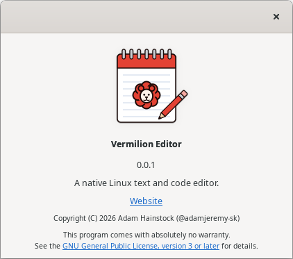

<p align="center">
  
</p>

<h1 align="center">Vermilion Editor</h1>

<p align="center">
  <a href="https://github.com/adamjeremy-sk/Vermilion-Editor/actions/workflows/ci.yml"></a>
</p>

<p align="center">
  A native Linux code editor with a built-in AI agent, build and debug support, and a live model monitor.<br>
  C++17 &middot; GTK 4 &middot; GtkSourceView 5 &middot; GPL-3.0-or-later
</p>

> **Status: pre-alpha. It opens, edits and saves files, but it is not ready for daily use.**
>
> **Done.** M0 (foundation) and M1 (the ctxmon monitor logic). Log and timing parsing, server responses, server state and
> warnings, graph geometry and GPU memory readers are ported, hardened against hostile input and tested.
>
> **Under way: M2, the editor.** The main window exists (menus, fixed-width tabs, status bar, the classic look below). Files can
> be opened and saved, with encodings, line endings and the close and quit questions (M2.2). The user manual opens inside the
> program under Help → Index or F1 (M2.2b).
>
> **Done: M2.2c, crash recovery.** Edited documents, untitled ones included, are copied to recovery files shortly after you stop
> typing. If the editor crashes or is killed, the next start asks about each copy: Recover, Discard or Decide Later (Recover All
> when several wait). It was tried on a 50 MB file without any lag.
>
> **Next.** Search and replace (M2.3), then the file monitor and settings in M2. The ctxmon window is its own milestone, M5.
>
> 482 tests, all passing at the last commit. Everything under "Planned" is a plan, not a feature you can use. See [Status](#status).

**Progress**: `████░░░░░░░░░░░░░░░░` 21% (weighted: M0 and M1 done; M2 7 of 12) ([roadmap](docs/roadmap.md))

<p align="center">
  
  <br><em>The current build (after M2.2b): the editor with tabs, syntax colours and the status bar; Help → Index showing the shortcuts topic; and Help → About.</em>
</p>

---

## Contents
1. [What Vermilion Editor is](#what-vermilion-editor-is)
2. [Status](#status)
3. [The window](#the-window)
4. [Planned features](#planned-features)
5. [The AI agent](#the-ai-agent)
6. [ctxmon (model monitor)](#ctxmon-model-monitor)
7. [Project file](#project-file)
8. [Configuration and data](#configuration-and-data)
9. [Building](#building)
10. [Repository layout](#repository-layout)
11. [How the project is developed](#how-the-project-is-developed)
12. [Roadmap](#roadmap)
13. [Feedback](#feedback)
14. [Licence](#licence)

---

## What Vermilion Editor is
A text and source-code editor for Linux (Ubuntu 24.04 is the reference system), written in C++17 on GTK 4 and
GtkSourceView 5. It is aimed at people who write code with an AI agent next to them and want one native window for the
whole loop: edit, ask the agent, review what it changed, build, run, debug and watch the model that is serving it.

Principles:
- **Native and direct.** GTK 4 and GLib through their plain C APIs; no language bindings, no vendor SDKs, nothing that only
  wraps another API. The agent speaks the llama.cpp server's OpenAI-compatible HTTP API itself; builds and debuggers run as subprocesses.
- **The agent is built in, not bolted on.** It works through the editor's own tools, under permission presets you control.
- **Reviewable.** Every agent turn is a change set you can read side by side and revert as a whole.
- **Local first.** The agent is built for a local llama.cpp server, with a monitor for it. Other OpenAI-compatible servers work too (you bring your own key through an environment variable), but they are not the goal.
- **Linux only.** Wayland and X11 through GTK. English interface. No telemetry.

---

## Status

| Area | State |
|---|---|
| Editor, ctxmon window and tab, tree, build, terminal (v0.1) | M1 done: ctxmon logic (log and timing lines, server responses, server state and warnings, graph geometry, GPU memory), hardened against hostile input. M2 under way: large-file and look spikes done (M2.0); the main window done (M2.1: menus, tabs, status bar, close and quit questions) and the application icon (M2.1c); opening and saving files with encodings and line endings (M2.2); Help → Index, the manual inside the program (M2.2b); crash recovery (M2.2c) |
| Agent (v0.2) | Designed, not started |
| Debugger (v0.3) | Designed, not started |
| Cost, project file, gate framework (v0.4) | Designed, not started |
| Code | M0 and M1 done; M2 under way (7 of 12 gates). 482 tests, all passing at the last commit. Next: M2.3, search. What each gate built is listed below |
| Releases | None |

### Built so far
Each item is one finished gate; the test count is the total after that gate.

- **M0, foundation.** CMake build, an empty window, the `Result` type, logging with secret masking, the `gtkx` helpers, and
  two repository checks (source headers and file sizes; code format).
- **M1, ctxmon logic.** `src/ctxmon/core` holds all of ctxmon's logic: llama.cpp log token and timing lines, the `/slots`,
  `/props` and `/v1/models` responses, server state with warnings at 80% and 95%, graph geometry, and AMD sysfs and
  `nvidia-smi` GPU memory. It is tested against the Python original and hardened against hostile input (a 1 MiB cap and a
  nesting limit for server responses, bounded GPU file reads, tests with 1 MB lines and huge numbers). 117 tests.
- **M2.0, two spikes.** Large-file loading in GtkSourceView, and the classic stylesheet with dark-mode detection. Both were
  throwaway programs and were deleted in M2.1.
- **M2.1, the main window.** A `DocumentList` in core (documents in tab order, untitled numbering, which document becomes
  active when one closes) and the window in `src/ui`: menu bar, fixed-width document tabs, status bar, and the close and
  quit questions. The stylesheet and the menus are compiled in as resources. 131 tests.
- **M2.1c, the application icon.** Rendered from the SVG masters at every build, compiled in, and shown in About and by the
  desktop. 132 tests.
- **M2.1d, continuous integration.** GitHub Actions configures, builds and tests every push and pull request to `main` on a
  clean Ubuntu 24.04. 132 tests.
- **M2.2, opening and saving files.** A core scanner reads each file once before it loads and decides the encoding (UTF-8,
  UTF-16 with its mark, Windows-1252 or Latin-1), the byte-order mark, the line endings, and whether the file is binary or
  has a line over 350,000 characters (which asks first). Saving keeps the encoding, the mark and the line endings. Save,
  Save As, the Encoding and Line Ending menus and the close and quit questions work, and a 38.9 MB file saves in 6.5 s.
  205 tests. This was the first gate where the coding agent wrote implementations from written specifications.
- **M2.2b, the manual inside the program.** Help → Index (F1) opens the user manual in its own window. Every
  `docs/manual/*.md` is compiled in as a resource, so a new topic needs no code change. A small renderer for a Markdown subset
  (headings, paragraphs, lists, bold, inline code, tables, links between topics) turns a page into labels and grids, and Back
  and Index buttons walk a tested page history. Tests keep every manual file inside the subset, linked from the index and equal
  to the compiled copy. 259 tests. The renderer, the page history and the help window were written by the coding agent from
  specifications.

---

## The window

Vermilion ships as three programs: **`vermilion`**, the light editor (a gedit replacement: the editor, tabs, search and settings,
no folder, panels or agent); **`vermilion-ide`**, the whole IDE; and **`ctxmon`**, the model monitor. The two editors share one
code base, so an improvement to editing reaches both. The window drawn below is `vermilion-ide`.

```
+------------------------------------------------------+------------------------+
| tabs: main.cpp | util.h | ...                        | Files | Agent | ctxmon |
|------------------------------------------------------|------------------------|
|                                                      | v project/             |
|   editor (syntax colours, line numbers,              |   v src/               |
|   breakpoint dots, current-line arrow)               |     main.cpp           |
|                                                      |     util.h             |
|                                                      |   CMakeLists.txt       |
|------------------------------------------------------|------------------------|
| Output | Problems | Terminal | Debug                  | Agent: chat, diff;     |
|   build log, clickable errors                        | ctxmon: server monitor |
+------------------------------------------------------+------------------------+
```
One window, one opened folder. The right-hand stack has three tabs: the directory sidebar (**Files**), the **Agent** and **ctxmon**, the live model monitor (which also exists as a standalone program). The bottom panel
has the build output, the problem list, terminals and the debugger views. There is no toolbar: the window is
keyboard first, and every command is a menu item that shows its shortcut.

Today (after M2.2b) the window has the menu bar, the document tabs with the editor, and the status bar. The right-hand stack
arrives with the directory sidebar (M3), the bottom panel with the build gates (M4), the Agent tab with M6 and the ctxmon tab
with M5.

---

## Planned features

### Editor (v0.1)
- Tabs; open and save; line endings detected and preserved (LF for new files) and changed from the Line Ending button in the
  status bar. **Built (M2.2).**
- Encodings: UTF-8 by default; a file that is not UTF-8 opens as UTF-16 (when it starts with its mark), Windows-1252 or
  Latin-1, in that order, and the status bar always says so. The Encoding button keeps two actions apart: "Reopen as…"
  reads the file again in another encoding, "Save as…" converts it at the next save. **Built (M2.2).**
- Safe saving: the text is written to a new file beside the original, flushed to disk and only then swapped in, so a power
  cut or a full disk never leaves a half-written file. Closing an edited tab asks Save, Close Without Saving or Cancel;
  quitting asks about each edited document in turn. **Built (M2.2).**
- Crash recovery: edited documents, untitled ones included, are copied to recovery files shortly after you stop typing; if
  Vermilion did not close properly, the next start asks about each copy (Recover, Discard or Decide Later, or Recover All),
  with the time of the copy and whether the file changed since. **Built (M2.2c).**
- Syntax highlighting, line numbers and colour schemes from GtkSourceView. Highlighting (the language is guessed from the
  file name and set after the file has loaded) and line numbers are **built (M2.2)**, with the classic colour scheme; choosing
  another scheme, a dark one, and choosing the language by hand come later (settings, M2.5).
- A fixed classic Windows 2000 look: one stylesheet over the desktop's own GTK theme, system fonts, no icons apart from the
  application's own (a small badge in the title bar, the full icon in Alt+Tab and About), square bevelled
  controls; a light and a dark palette, with colour mode Light, Dark or Follow system. The light palette and the icons are
  **built (M2.1, M2.1c)**; the dark palette and the colour mode setting come with M2.5.
- Keyboard first: a menu bar and a gedit-style status bar (language, tab width, encoding, line ending, line and column,
  INS/OVR), no toolbar. Familiar shortcuts (Ctrl+N, Ctrl+O, Ctrl+S, Ctrl+W, Ctrl+F, F3, Ctrl+H, Ctrl+G), and F5, F7 and
  F9 to F11 for building and debugging. The menu bar, the status bar and the file, edit, tab and help shortcuts are
  **built (M2.1 to M2.2b)**; the language and tab width panels only show their value for now, and the search shortcuts and the
  build and debug keys arrive with their features.
- Fixed-width document tabs with the close button at the right edge, an unsaved marker and drag to reorder; Vermilion never
  closes a tab on its own. **Built (M2.1).**
- Large files load in the background with syntax colouring switched on after the load: a 50 MB C++ file opens in about
  4 seconds instead of 87 (measured in the M2.0a spike). A file with an extremely long line (over 350,000 characters; it
  can freeze any GTK text view) or with NUL bytes (a binary file) asks "Open anyway / Cancel" first. Word wrap is always
  off when a file opens and is switched on per document. **Built (M2.2).**
- A user manual inside the program: Help → Index (F1) shows the topics of `docs/manual` in a read-only window, one page at a
  time, with links between topics and Back and Index buttons. **Built (M2.2b).**
- The light program: `vermilion` is a plain text editor for quick edits, a replacement for gedit or Mousepad (File, Edit,
  Search, View and Help menus only), and `vermilion-ide` is the whole IDE. Both are built from the same editor code (M2.6b).
- Search and replace with regular expressions, go to line.
- External changes: a clean buffer reloads automatically when the file changes on disk; a modified buffer shows a banner with
  Reload, Keep mine and Show diff.

### Directory sidebar (v0.1)
On the right-hand side. One tree of folders and files (folders first), lazy loading, a file filter, a hidden-files toggle
(off by default), a Sync button that follows the active tab, rename, delete (to trash), copy and move, drag and drop, and
automatic refresh. The behaviour is specified in [`docs/requirements/directory-sidebar.md`](docs/requirements/directory-sidebar.md).

### Build, Output and Problems (v0.1)
Per-folder build and run commands in `.vermilion/project.json`, with presets that detect CMake, Make, Ninja, Cargo, Gradle and
Bazel. Output streams into the Output pane; compiler errors from gcc, clang, rustc and javac become a Problems list and
clickable links to the source line.

### Terminal (v0.1)
The terminal (VTE) is built first as part of ctxmon (M5.3), so you can restart a server from the monitor. Whether the editor's
bottom panel also gets terminal tabs (the same terminal, started in the opened folder, for Run and Debug) is still open.

### Debugger (v0.3)
Debug Adapter Protocol, using gdb's built-in adapter first (C, C++, Rust). Click the gutter to set a breakpoint; continue, step
over, step into, step out; call stack, local variables and watch expressions; the current line is marked in the editor.
Not planned for the first version: attach, core dumps, remote debugging.

---

## The AI agent
Planned for v0.2 and later; the design is in [`ARCHITECTURE.md`](ARCHITECTURE.md) section 7.6.

**Provider.** The agent talks to a local llama.cpp server through the OpenAI-compatible API (start the server with `--jinja`
for tool calls). Any other OpenAI-compatible server works as well, but nothing else is built: native Anthropic and Gemini
adapters, MCP and key storage in the system keyring are parked in [`docs/ideas.md`](docs/ideas.md). Replies stream in and can
be stopped at any time.

**Setup dialog.** The first time you open the Agent tab, a dialog takes care of everything: base URL, the name of the
environment variable that holds the API key if the server needs one (Vermilion stores no key), model, a connection test and the
permission preset. If a llama.cpp server is running locally, it fills in the model and context size and offers the ctxmon tab.

**Tools.** The agent works through the editor: read a file (line ranges), replace text, create a file, list a directory, search,
open a file in a tab, run the build, and run a shell command.

**Permission presets.**

| Preset | Edits | Shell | Network |
|---|---|---|---|
| **Restricted** (default) | ask each time | ask each time | model endpoints only |
| **Balanced** | free inside the folder | free, with a deny list (commit, push, destructive git, writes outside the folder) | model endpoints only |
| **Unrestricted** | free | free | free |
| **Custom** | your JSON rules | your JSON rules | your JSON rules |

Unrestricted needs a confirmation and shows a red badge. In every preset the agent cannot change its own preset and cannot
read your API keys. A default list of files that are never sent to a remote endpoint (`.env`, `*.pem`, `id_*`, `*secret*`)
is enforced, the status bar shows whether the active endpoint is local, on your network or remote, and a request log records
what was sent (not the prompt text, unless you turn that on).

**Reviewing what the agent did.** Every turn is a change set shown in a side-by-side diff with folding, and a whole turn can
be reverted. Files are snapshotted before the agent's first edit, so reverting does not depend on git. Changes made by shell
commands the agent runs are not tracked.

**Chat.** `/clear` saves the conversation to an archive and starts fresh; `/history` opens archived chats; `/copy` copies the
last output, and every message, code block and generated prompt has a Copy button. Slash commands are Markdown templates in
`.vermilion/commands/`.

**Gate framework.** `/gate <task>` builds a self-contained work prompt (context, rails, steps, evidence) from your project file
and the live state of the tree and shows it with a one-click Copy; `/audit` takes the report that comes back, checks it with the
agent's tools and gives a verdict. The templates are yours to edit.

**Cost.** Enter input and output prices per million tokens for any endpoint, including your local model, to see what the same
work would cost on a paid model. No prices are shipped.

---

## ctxmon (model monitor)
ctxmon is a live monitor for a running llama.cpp server, a native C++ port of Adam's `ctxmon`. It is developed in this
repository: its logic lives in `src/ctxmon/core` (no GTK) and its window in `src/ctxmon/ui`. The Python original in
[`reference/ctxmon/`](reference/ctxmon/) is frozen and only supplies the expected values for the tests; it is removed once
the port is complete (gate M5.6), after which the repository contains no Python. ctxmon comes in two forms that share the same
logic and the same cards:

- **Built in:** the **ctxmon** tab in the right-hand stack of `vermilion-ide`, next to Files and Agent, so the server your agent is using is one click away.
- **Standalone:** a separate program, `ctxmon`, with its own window. It needs no editor and no folder, so
  you can watch a server while you work in any other tool. It is built from the same source tree.

What a card shows (one per server, several servers side by side):

- **Context:** percentage and bar, with tokens used, total and free. It says whether the number is exact (the request finished and
  the server log confirmed it) or an estimate (a request is still running).
- **Speed:** generation speed (live while generating, otherwise the last request) and prompt-processing speed.
- **Graphs:** context over time and speed over time.
- **Recent requests:** the newest finished requests with prompt and generated tokens, speeds and the context size afterwards.
- **Warnings:** at 80% and 95% of the context, as a banner in the card and as a desktop notification.
- **GPU memory:** VRAM used and total (AMD through sysfs, or `nvidia-smi`).
- **Terminal:** shell tabs (VTE) so you can restart a server without leaving the window.

It polls each server's `/slots` and `/props` endpoints and reads the server log (start the server with `--log-file`) for token counts
and finished requests. It only talks to your own servers, and shows zeros when nothing is listening. Differences from the Python
original: GTK 4 has no tray icon, so there is none; notifications go through `GNotification`; and there is no "time until full"
estimate, because it jumped by minutes with every change in the speed figure. Settings are remembered between
runs; their file name is fixed when it is first written.

---

## Project file
A project has two files in its folder (names provisional): `PROJECT.md`, a readable description of the purpose, layout,
conventions, decisions and current state that the agent reads first and helps keep up to date, and `.vermilion/project.json`
with the build, run and debug configurations and per-project settings. **New Project** creates both from a wizard; **Open
Folder** can "Adopt as project", where the agent reads the tree and writes the first description.

---

## Configuration and data
Everything follows the XDG directories; nothing is written next to the executable.

| What | Where |
|---|---|
| Application settings | `~/.config/vermilion/settings.ini` |
| Agent endpoints, presets and rules (JSON) | `~/.config/vermilion/agent.json` |
| Per-project settings | `<folder>/.vermilion/project.json`, `<folder>/PROJECT.md` |
| Chat archive | `~/.local/share/vermilion/chats/` |
| Revert snapshots | `~/.cache/vermilion/snapshots/` |
| Request log | `~/.local/state/vermilion/requests.log` |
| API keys | not stored: `agent.json` names an environment variable |

File names are provisional until the gates that create them. Settings can be changed in the application or by editing the files.

---

## Building
Reference system: Ubuntu 24.04. Install the development packages:

```bash
sudo apt install build-essential cmake pkg-config libgtk-4-dev libgtksourceview-5-dev libjson-glib-dev \
  libsoup-3.0-dev libsecret-1-dev libvte-2.91-gtk4-dev libgtest-dev librsvg2-bin clang-format clang-tidy
```

Then:

```bash
git clone https://github.com/adamjeremy-sk/Vermilion-Editor.git
cd Vermilion-Editor
cmake -S . -B build
cmake --build build
ctest --test-dir build --output-on-failure
```

Optional: `python3 tools/ctxmon_oracle.py` regenerates the ctxmon tests' expected values from the Python original
(`tests/ctxmon/fixtures/expected/`); the build does not need Python. The script goes away with the Python original (M5.6).

The test run includes two repository checks: `SourceCheck.Repo` (`tools/check_sources.sh`: licence header, purpose comment
and size of every source file) and `Format.Check` (`tools/check_format.sh`: `clang-format --dry-run --Werror` on every `.cpp`
and `.h` file; reported as skipped, not failed, when clang-format is not installed).

GitHub Actions runs the same steps on a clean Ubuntu 24.04 for every push and pull request to `main`
(`.github/workflows/ci.yml`, the CI badge at the top).

The project is developed in CLion; opening the folder picks up `CMakeLists.txt`. `build/`, `cmake-build-*/`, `.idea/` and
`evidence/` (command output saved for audits) are ignored by git. There is nothing to install and no release yet.

`librsvg2-bin` provides `rsvg-convert`, which the build uses to render the application icons from the SVGs in `res/vedt/`
(from M2.1c); the program itself does not need it. CMake stops at configure with the package name if it is missing.

Vermilion logs through GLib under the log domain `vermilion`, with secrets masked before anything is written. As in any GLib
program, debug and info messages are hidden by default; run with `G_MESSAGES_DEBUG=vermilion` (or `all`) to see them.

---

## Repository layout

| Path | Contents |
|---|---|
| `src/core/` | UI-free logic. Built: the document list, the text scanner and encodings, the manual's Markdown parser and page history, message texts, logging and the `Result` type. Planned: diff engine, permission engine, build presets and problem matchers, the debug-protocol client, slash commands, cost, archive. No GTK headers. |
| `src/ctxmon/core/` | ctxmon logic, UI-free: log token and timing lines, server API responses, server state and warnings, graph geometry, VRAM readers. No GTK headers. |
| `src/ctxmon/ui/` | *(M5)* The ctxmon cards, graphs and terminal, shared by the ctxmon tab and the standalone `ctxmon`. |
| `src/agent/` | The provider adapter, the agent loop, the tool registry. No GTK headers. |
| `src/ui/` | The GTK application: main window and actions, document tabs and editor pages, the open and save flow, the status bar, the help window and the compiled-in resources (stylesheet, menus, icons, manual). `gtkx/` is a small helper layer (GObject reference pointer, signal connection by lambda, string conversion, a guard for asynchronous callbacks). At M2.6b the editor code becomes a library shared by `vermilion` and `vermilion-ide` (ARCHITECTURE.md 7.12). |
| `tests/` | GoogleTest tests for core and agent; `tests/ctxmon/` for ctxmon, with sample llama.cpp logs and responses and fake GPU sysfs trees in `fixtures/`. |
| `tools/` | Repository checks run by `ctest` (`check_sources.sh`, `check_format.sh`) and `ctxmon_oracle.py`, which writes the ctxmon tests' expected values (until M5.6). |
| `.github/workflows/` | `ci.yml`: the continuous-integration run on GitHub Actions (configure, build, full test run on Ubuntu 24.04). |
| `res/vedt/` | Vermilion's own artwork as SVG masters: application icon, small icon, logo (the build renders the icons to PNG). |
| `res/github/` | Images used by this README (screenshots). |
| `reference/ctxmon/` | The Python original of ctxmon (`ctxmon_gtk.py`, frozen; test oracle until M5.6) and its logo (`ctxmon.svg`). Not built. |
| `docs/manual/` | The user manual, one short topic per file ([index](docs/manual/index.md)). |
| `docs/roadmap.md` | The milestone and gate plan. |
| `docs/milestones/` | Milestone reviews (what was done, what was learned, what comes next). |
| `docs/requirements/` | Behaviour specifications, for example the directory sidebar. |
| `ARCHITECTURE.md` | The decided architecture. |
| `AGENTS.md`, `AI_ONBOARDING.md`, `HANDOFF.md` | The development process: rules for the coding agent, how the process works, and where it stands. |
| `opencode.json` | Configuration of the local coding agent's model and permissions. Do not edit casually. |

---

## How the project is developed
Vermilion Editor is developed with AI assistance in a structured way, and the structure is part of the repository.

- **Adam**, the owner, decides, builds, tests and commits. The coding agent never commits or pushes.
- **An orchestrator** (Claude, working in a claude.ai Project) plans the work, writes self-contained prompts, audits every
  result against the real tree with fresh commands, and maintains the documentation.
- **A local coding agent** (Qwen3.8-27B served by llama.cpp, driven through OpenCode) makes the code changes, one logical step
  per session, following [`AGENTS.md`](AGENTS.md). Since M2.2 it also writes implementation files from written specifications,
while the orchestrator dictates the headers, the tests and the most delicate wiring; the audit is then a code review against
the specification and the tests.

Work proceeds in **gates**: small steps, each ending with verbatim evidence and an audit verdict (pass, pass with notes, or fail)
before the next one starts. Every gate that adds code adds its tests. The agent features of Vermilion itself will standardise
this process (`/gate` and `/audit`).

---

## Roadmap
The plan is in [`docs/roadmap.md`](docs/roadmap.md):

| Version | Contents |
|---|---|
| v0.1 | The light editor `vermilion` and the IDE `vermilion-ide` (right-hand directory sidebar, build and Output pane, Problems, terminal), ctxmon (standalone `ctxmon` and the ctxmon tab) |
| v0.2 | Agent core, local first: llama.cpp through the OpenAI-compatible API, tools, permission presets, setup dialog, chat, archive, side-by-side diff, whole-turn revert |
| v0.3 | Debugger |
| v0.4 | Cost display, project file, gate framework |
| v1.0 | Packaging, documentation, notices |

---

## Feedback
Bug reports, ideas and questions are welcome as [GitHub issues](https://github.com/adamjeremy-sk/Vermilion-Editor/issues).
The project is at its very beginning and not yet organised for outside code contributions.

---

## Licence
Vermilion Editor is free software under the **GNU General Public License, version 3 or (at your option) any later version**
(GPL-3.0-or-later). See [`LICENSE`](LICENSE).

Copyright (C) 2026 Adam Hainstock (@adamjeremy-sk)

Every source file carries an SPDX licence header. The model monitor began as a port of ctxmon from
[llm-suite-test](https://github.com/adamjeremy-sk/llm-suite-test), also by the author; it is now developed here. The libraries used (GTK, GtkSourceView,
GLib, json-glib, libsoup, VTE) are LGPL-licensed; GoogleTest is BSD-licensed. A full third-party notice file will be added before
the first release.
