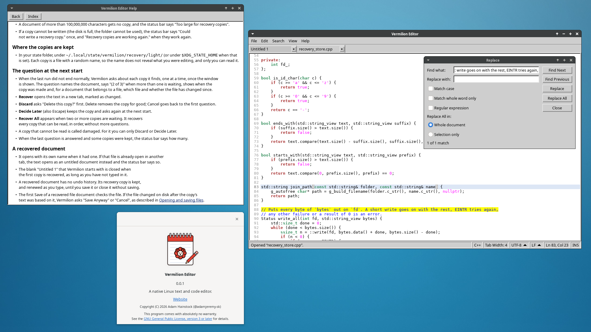

<p align="center">
  
</p>

<h1 align="center">Vermilion Editor</h1>

<p align="center">
  <a href="https://github.com/adamjeremy-sk/Vermilion-Editor/actions/workflows/ci.yml"></a>
  <a href="https://hub.xerj.org/contributors/adamjeremy-sk"></a>
</p>

<p align="center">
  <strong>Progress</strong>: <code>████░░░░░░░░░░░░░░░░</code> 21% (weighted: M0 and M1 done; M2 8 of 15) (<a href="docs/roadmap.md">roadmap</a>)
</p>

<p align="center">
  A native Linux code editor with a built-in AI agent, build and debug support, and a live model monitor.<br>
  C++17 &middot; GTK 4 &middot; GtkSourceView 5 &middot; GPL-3.0-or-later
</p>

> **Status: pre-alpha.** It opens, edits and saves files, finds and replaces text, and recovers documents after a crash.
> It is not ready for daily use, and everything marked "Planned" is a plan. See [Status](#status).

<p align="center">
  
  <br><em>The current build (after M2.3): tabs, syntax colours, the shaded current line, the status bar and the Replace window; Help → Index; Help → About.</em>
</p>

---

## Contents
1. [What Vermilion Editor is](#what-vermilion-editor-is)
2. [Status](#status)
3. [The window](#the-window)
4. [Planned features](#planned-features)
5. [The AI agent](#the-ai-agent)
6. [ctxmon (model monitor)](#ctxmon-model-monitor)
7. [Project file](#project-file)
8. [Configuration and data](#configuration-and-data)
9. [Building](#building)
10. [Repository layout](#repository-layout)
11. [How the project is developed](#how-the-project-is-developed)
12. [Roadmap](#roadmap)
13. [Feedback](#feedback)
14. [Licence](#licence)

---

## What Vermilion Editor is
A text and source-code editor for Linux (Ubuntu 24.04 is the reference system), written in C++17 on GTK 4 and
GtkSourceView 5. It is for people who write code with an AI agent beside them and want one native window for the whole
loop: edit, ask the agent, review its changes, build, run, debug and watch the model that serves it.

- **Native and direct.** GTK 4 and GLib through their plain C APIs; no language bindings or vendor SDKs. The agent speaks
  the llama.cpp server's OpenAI-compatible HTTP API itself; builds and debuggers run as subprocesses.
- **A built-in agent.** It works through the editor's own tools, under permission presets you control.
- **Reviewable.** Every agent turn is a change set you can read side by side and revert.
- **Local first.** Built for a local llama.cpp server, with a monitor for it. Other OpenAI-compatible servers work, with
  a key taken from an environment variable.
- **Linux only.** Wayland and X11 through GTK. English interface. No telemetry.

---

## Status
M0 and M1 are done (the foundation and the ctxmon logic). M2, the editor, is under way: 8 of 15 gates. 715 tests, all
passing at the last commit. Everything after M2 is designed, not started. There are no releases yet.

### Built so far
Each row is one finished gate; the test count is the total after that gate.

| Gate | What it built | Tests |
|---|---|---|
| M0, foundation | CMake build, an empty window, the `Result` type, logging with secret masking, the `gtkx` helpers, repository checks for headers, file sizes and format | – |
| M1, ctxmon logic | `src/ctxmon/core`: log token and timing lines, server responses, server state with warnings at 80% and 95%, graph geometry, GPU memory; tested against the Python original and hardened against hostile input | 117 |
| M2.0, spikes | Large-file loading in GtkSourceView; the classic stylesheet with dark-mode detection (throwaway programs) | – |
| M2.1, main window | Menu bar, fixed-width tabs, status bar, close and quit questions; `DocumentList` in core | 131 |
| M2.1c, icon | Rendered from the SVG masters at every build; shown in About and by the desktop | 132 |
| M2.1d, CI | GitHub Actions builds and tests every push and pull request to `main` on Ubuntu 24.04 | 132 |
| M2.2, open and save | A core scanner decides encoding, byte-order mark, line endings and binary files; saving keeps them; Save, Save As, Encoding and Line Ending menus; a 38.9 MB file saves in 6.5 s | 205 |
| M2.2b, manual | Help → Index (F1); every `docs/manual/*.md` is compiled in; a Markdown-subset renderer and a page history | 259 |
| M2.2c, crash recovery | Edited documents are copied after you stop typing; after a crash the next start offers Recover, Discard or Decide Later | 482 |
| M2.3, search | Find, Replace and Go to Line windows; regular expressions; match counts; Replace All as one Undo step, sliced and cancellable on huge files (50 MB, 289,000 matches in about a minute); the current line is shaded | 715 |

---

## The window
Vermilion ships as three programs: **`vermilion`**, the light editor (a gedit replacement: editor, tabs, search and
settings; no folder, panels or agent); **`vermilion-ide`**, the whole IDE; and **`ctxmon`**, the model monitor. The two
editors share one code base. The window drawn below is `vermilion-ide`.

```
+------------------------------------------------------+------------------------+
| tabs: main.cpp | util.h | ...                        | Files | Agent | ctxmon |
|------------------------------------------------------|------------------------|
|                                                      | v project/             |
|   editor (syntax colours, line numbers,              |   v src/               |
|   breakpoint dots, current-line arrow)               |     main.cpp           |
|                                                      |     util.h             |
|                                                      |   CMakeLists.txt       |
|------------------------------------------------------|------------------------|
| Output | Problems | Terminal | Debug                  | Agent: chat, diff;     |
|   build log, clickable errors                        | ctxmon: server monitor |
+------------------------------------------------------+------------------------+
```
One window, one opened folder. The right-hand stack has the directory sidebar (**Files**), the **Agent** and **ctxmon**
(which also exists as a standalone program). The bottom panel has build output, problems, terminals and the debugger
views. There is no toolbar: every command is a menu item that shows its shortcut.

Today (after M2.3) the window has the menu bar, tabs, the editor, the status bar and the search windows. The right-hand
stack arrives with M3, the bottom panel with M4, the Agent tab with M5 and the ctxmon tab with M6.

---

## Planned features
Rows marked Built exist today; everything else is a plan.

### Editor and IDE
| Feature | State | What it does |
|---|---|---|
| Tabs, open and save | Built (M2.2) | Line endings are detected and kept (LF for new files); the Line Ending button converts |
| Encodings | Built (M2.2) | UTF-8, else UTF-16 (with its mark), Windows-1252 or Latin-1; the Encoding button offers "Reopen as…" and "Save as…" |
| Safe saving | Built (M2.2) | Written beside the original, flushed, then swapped in, so a crash or a full disk never leaves half a file. Closing or quitting with edited documents asks Save, Close Without Saving or Cancel |
| Crash recovery | Built (M2.2c) | Edited documents are copied to recovery files; the next start offers Recover, Discard or Decide Later, with the time of the copy and whether the file changed |
| Syntax highlighting | Built (M2.2) | GtkSourceView; the language is guessed from the file name; classic scheme. Other schemes and choosing the language come with settings (M2.5) |
| Classic Windows 2000 look | Light palette built (M2.1) | One stylesheet over the GTK theme, system fonts, square bevelled controls. The dark palette and the colour mode setting come with M2.5 |
| Keyboard first | Built (M2.1 to M2.3) | Gedit-style status bar, no toolbar, every command a menu item with its shortcut. Build and debug keys come with their features |
| Fixed-width tabs | Built (M2.1) | Close button at the right edge, an unsaved marker, drag to reorder; a tab is never closed on its own |
| Large files | Built (M2.2) | Loaded in the background, highlighting switched on afterwards: a 50 MB C++ file opens in about 4 s instead of 87. A binary file or a line over 350,000 characters asks "Open anyway / Cancel" |
| Manual inside the program | Built (M2.2b) | Help → Index (F1): the topics of `docs/manual` in a read-only window, with links, Back and Index |
| Search, replace, go to line | Built (M2.3) | Find (Ctrl+F), Replace (Ctrl+H), Go to Line (Ctrl+G, `line` or `line:column`); match case, whole word, regular expressions; match count; F3 and Shift+F3; Replace All is one Undo step |
| External changes | Under way (M2.4) | A clean buffer reloads when the file changes on disk; a modified one shows a banner with Reload and Keep mine |
| Help window | Planned (M2.5b) | A Contents tree, a Search tab, and Back, Forward and Hide buttons |
| Diff view | Planned (M2.6) | Side by side with folding; opened from the external-change banner and the crash-recovery question |
| Open Recent | Planned (M2.7c) | File → Open Recent, with a way to clear the list |
| The light program | Planned (M2.7b) | `vermilion` as a plain editor for quick edits, a replacement for gedit or Mousepad; both programs are built from the same editor code |

Known limits of search: Undo of a huge Replace All takes longer than the run, one enormous line with many matches can
slow the window, and there is no search history.

### Other parts
| Part | Version | What it will do |
|---|---|---|
| Directory sidebar | v0.1.0 | A right-hand tree (folders first, lazy loading), filter, hidden-files toggle, Sync, rename, delete to trash, copy, move, drag and drop, automatic refresh. Specified in [`docs/requirements/directory-sidebar.md`](docs/requirements/directory-sidebar.md) |
| Build, Output and Problems | v0.2.0 | Per-folder build and run commands in `.vermilion/project.json`, with presets for CMake, Make, Ninja, Cargo, Gradle and Bazel. Errors from gcc, clang, rustc and javac become a Problems list with clickable links |
| Terminal | v0.4.0 | A VTE terminal, built first inside ctxmon (M6.3). Terminal tabs in the editor's bottom panel are still open |
| Debugger | v0.5.0 | Debug Adapter Protocol, gdb's adapter first (C, C++, Rust): gutter breakpoints, continue and step, call stack, locals, watches. Not planned at first: attach, core dumps, remote debugging |

---

## The AI agent
Planned for v0.3.0; the design is in [`ARCHITECTURE.md`](ARCHITECTURE.md) section 7.6.

- **Provider.** A local llama.cpp server through the OpenAI-compatible API (start it with `--jinja` for tool calls). Other
  OpenAI-compatible servers work, but nothing else is built; other providers, MCP and keyring storage are in
  [`docs/ideas.md`](docs/ideas.md). Replies stream in and can be stopped.
- **Setup dialog.** On first use: base URL, the name of the environment variable that holds the API key if one is needed
  (Vermilion stores no key), model, a connection test and the permission preset. A local llama.cpp server fills in the model
  and context size and offers the ctxmon tab.
- **Tools.** Thirteen, all through the editor: read, search, edit, create, file operations, read-only git, build, tests,
  format, shell and ask-the-user. Agent edits stay unsaved and undoable until saved.
- **Reviewing.** Every turn is a change set in a side-by-side diff; a whole turn or a single hunk can be reverted. Files are
  snapshotted before the first edit, so revert does not depend on git. Changes made by shell commands are not tracked.
- **Chat.** `/clear` archives the conversation and starts fresh; `/history` opens archived chats; `/copy` copies the last
  output; messages and code blocks have Copy buttons. Slash commands are Markdown templates in `.vermilion/commands/`.
- **Gate framework.** `/gate <task>` builds a self-contained work prompt from your project file and the live tree, with a
  Copy button; `/audit` checks the report that comes back and gives a verdict. The templates are yours to edit.
- **Cost.** Enter prices per million tokens for any endpoint to see what the same work would cost on a paid model. No prices
  are shipped.

**Permission presets.**

| Preset | Edits | Shell | Network |
|---|---|---|---|
| **Restricted** (default) | ask each time | ask each time | model endpoints only |
| **Balanced** | free inside the folder | free, with a deny list (commit, push, destructive git, writes outside the folder) | model endpoints only |
| **Unrestricted** | free | free | free |
| **Custom** | your JSON rules | your JSON rules | your JSON rules |

Unrestricted needs a confirmation and shows a red badge. In every preset the agent cannot change its own preset or read
your API keys. Files such as `.env`, `*.pem`, `id_*` and `*secret*` are never sent to a remote endpoint. The status bar shows
whether the endpoint is local, on your network or remote, and a request log records what was sent (not the prompt text,
unless you turn that on).

---

## ctxmon (model monitor)
ctxmon is a live monitor for a running llama.cpp server, a native C++ port of Adam's `ctxmon`. Its logic is in
`src/ctxmon/core` (no GTK) and its window in `src/ctxmon/ui`. The Python original in
[`reference/ctxmon/`](reference/ctxmon/) is frozen: it supplies the expected values for the tests and is removed at gate
M6.6, after which the repository holds no Python.

It comes in two forms that share the same logic and cards:
- **Built in.** The **ctxmon** tab of `vermilion-ide`, next to Files and Agent.
- **Standalone.** The program `ctxmon`, with its own window. It needs no editor and no folder.

One card per server, several servers side by side:
- **Context.** Percentage and bar, with tokens used, total and free; exact (the request finished and the log confirms it)
  or an estimate (a request is still running).
- **Speed.** Generation speed (live while generating, otherwise the last request) and prompt-processing speed.
- **Graphs.** Context and speed over time.
- **Recent requests.** The newest finished requests: prompt and generated tokens, speeds, and the context size afterwards.
- **Warnings.** At 80% and 95% of the context, as a banner in the card and a desktop notification.
- **GPU memory.** VRAM used and total (AMD through sysfs, or `nvidia-smi`).
- **Terminal.** Shell tabs (VTE), so a server can be restarted without leaving the window.

It polls each server's `/slots` and `/props` endpoints and reads the server log (start the server with `--log-file`). It
talks only to your own servers and shows zeros when nothing is listening. Unlike the Python original it has no tray icon
(GTK 4 has none; notifications use `GNotification`) and no "time until full" estimate, which jumped with every change in
speed. Settings are remembered between runs.

---

## Project file
A project has two files in its folder (names provisional). `PROJECT.md` is a readable description of the purpose, layout,
conventions, decisions and state; the agent reads it first and helps keep it up to date. `.vermilion/project.json` holds the
build, run and debug configurations and per-project settings. **New Project** creates both from a wizard; **Open Folder** can
"Adopt as project", where the agent reads the tree and writes the first description.

---

## Configuration and data
Everything follows the XDG directories; nothing is written next to the executable. File names are provisional until the
gates that create them.

| What | Where |
|---|---|
| Application settings | `~/.config/vermilion/settings.ini` |
| Agent endpoints, presets and rules (JSON) | `~/.config/vermilion/agent.json` |
| Per-project settings | `<folder>/.vermilion/project.json`, `<folder>/PROJECT.md` |
| Chat archive | `~/.local/share/vermilion/chats/` |
| Revert snapshots | `~/.cache/vermilion/snapshots/` |
| Editor colour scheme (a copy written on first use) | `~/.cache/vermilion/styles/` |
| Request log | `~/.local/state/vermilion/requests.log` |
| API keys | not stored: `agent.json` names an environment variable |

---

## Building
Reference system: Ubuntu 24.04. Install the development packages:

```bash
sudo apt install build-essential cmake pkg-config libgtk-4-dev libgtksourceview-5-dev libjson-glib-dev \
  libsoup-3.0-dev libsecret-1-dev libvte-2.91-gtk4-dev libgtest-dev librsvg2-bin clang-format clang-tidy
```

Then:

```bash
git clone https://github.com/adamjeremy-sk/Vermilion-Editor.git
cd Vermilion-Editor
cmake -S . -B build
cmake --build build
ctest --test-dir build --output-on-failure
```

- The test run includes two repository checks: `SourceCheck.Repo` (licence header, purpose comment and size of every source
  file) and `Format.Check` (`clang-format --dry-run --Werror`; skipped, not failed, when clang-format is missing).
- GitHub Actions runs the same steps on a clean Ubuntu 24.04 for every push and pull request to `main`.
- `librsvg2-bin` provides `rsvg-convert`, which the build uses to render the application icons from `res/vedt/`. CMake stops
  at configure with the package name if it is missing.
- Optional: `python3 tools/ctxmon_oracle.py` regenerates the ctxmon tests' expected values from the Python original. The
  build does not need Python, and the script goes away at M6.6.
- The project is developed in CLion. `build/`, `cmake-build-*/`, `.idea/` and `evidence/` are ignored by git. There is
  nothing to install and no release yet.
- Vermilion logs through GLib under the domain `vermilion`, with secrets masked. Run with `G_MESSAGES_DEBUG=vermilion` (or
  `all`) to see debug and info messages.

---

## Repository layout

| Path | Contents |
|---|---|
| `src/core/` | UI-free logic: the document list, text scanner and encodings, the manual's parser and page history, search options, replacement rules, Go to Line, message texts, logging, the `Result` type. Planned: diff and permission engines, build presets, the debug client, slash commands, cost, archive. No GTK headers |
| `src/ctxmon/core/` | ctxmon logic, UI-free: log lines, server responses, server state and warnings, graph geometry, VRAM readers. No GTK headers |
| `src/ctxmon/ui/` | *(M6)* The ctxmon cards, graphs and terminal, shared by the ctxmon tab and the standalone `ctxmon` |
| `src/agent/` | The provider adapter, the agent loop, the tool registry. No GTK headers |
| `src/ui/` | The GTK application: main window and actions, tabs and editor pages, the open and save flow, the search windows and Replace All job, the status bar, the help window, and the compiled-in resources. `gtkx/` is a small helper layer (reference pointer, signal connection by lambda, string conversion, a guard for asynchronous callbacks) |
| `tests/` | GoogleTest tests; `tests/ctxmon/` has sample llama.cpp logs and responses and fake GPU sysfs trees in `fixtures/` |
| `tools/` | Repository checks run by `ctest` (`check_sources.sh`, `check_format.sh`) and `ctxmon_oracle.py` (until M6.6) |
| `.github/workflows/` | `ci.yml`: configure, build and the full test run on GitHub Actions |
| `res/vedt/`, `res/github/` | Vermilion's artwork as SVG masters (the build renders the icons to PNG); images used by this README |
| `third_party/` | Vendored code, kept byte-exact and never edited: xxHash v0.8.3 (BSD-2-Clause; used from M2.4 for file-change detection), with its licence, a `.license` sidecar and a README |
| `LICENSES/` | The full texts of the licences in use (GPL-3.0-or-later, BSD-2-Clause), for REUSE |
| `reference/ctxmon/` | The Python original of ctxmon (frozen; test oracle until M6.6) and its logo. Not built |
| `docs/` | `manual/` (the user manual, one topic per file, [index](docs/manual/index.md)), `roadmap.md`, `gate-details.md`, `milestones/` (reviews), `requirements/` (behaviour specifications) |
| `ARCHITECTURE.md` | The decided architecture |
| `AGENTS.md`, `AI_ONBOARDING.md`, `HANDOFF.md` | The development process: rules for the coding agent, how the process works, and where it stands |
| `opencode.json` | Configuration of the local coding agent's model and permissions. Do not edit casually |

---

## How the project is developed
Vermilion Editor is developed with AI assistance in a structured way, and the structure is part of the repository.

- **Adam**, the owner, decides, builds, tests and commits. The coding agent never commits or pushes.
- **An orchestrator** (Claude, working in a claude.ai Project) plans the work, writes self-contained prompts, audits every
  result against the real tree with fresh commands, and maintains the documentation.
- **A local coding agent** (Qwen3.8-27B served by llama.cpp, driven through OpenCode) makes the code changes, one logical
  step per session, following [`AGENTS.md`](AGENTS.md). Since M2.2 it also writes implementation files from written
  specifications; the orchestrator dictates the headers, the tests and the most delicate wiring.

Work proceeds in **gates**: small steps, each ending with verbatim evidence and an audit verdict (pass, pass with notes, or
fail) before the next one starts. Every gate that adds code adds its tests. The agent features of Vermilion itself will
standardise this process (`/gate` and `/audit`).

---

## Roadmap
The plan is in [`docs/roadmap.md`](docs/roadmap.md); the longer description of each gate is in
[`docs/gate-details.md`](docs/gate-details.md).

| Version | Contents |
|---|---|
| 0.1.0 | The light editor `vermilion` and the IDE `vermilion-ide`: editor, search, settings, crash recovery, a diff view and the right-hand directory sidebar (M0 to M3) |
| 0.2.0 | Build and run, Output pane, Problems (M4) |
| 0.3.0 | Agent core, local first: tools, permission presets, setup dialog, chat, archive, staged edits, whole-turn and per-hunk revert (M5) |
| 0.4.0 | ctxmon: cards, graphs, the terminal, the standalone `ctxmon` and the ctxmon tab (M6) |
| 0.5.0 | Debugger (M7) |
| 0.6.0 | Cost display, project file, gate framework (M8) |
| 0.9.0 | Packaging and release (M9); then an 8-week beta and 1.0.0 |

---

## Feedback
Bug reports, ideas and questions are welcome as [GitHub issues](https://github.com/adamjeremy-sk/Vermilion-Editor/issues).
The project is at its very beginning and not yet organised for outside code contributions.

---

## Licence
Vermilion Editor is free software under the **GNU General Public License, version 3 or (at your option) any later version**
(GPL-3.0-or-later). See [`LICENSE`](LICENSE).

Copyright (C) 2026 Adam Hainstock (@adamjeremy-sk)

Every source file carries an SPDX licence header. REUSE certification (https://reuse.software) is an objective: files
created from 2026-11-17 on carry their licence information, and older files are brought into line at M9. The model monitor
began as a port of ctxmon from [llm-suite-test](https://github.com/adamjeremy-sk/llm-suite-test), also by the author. The
libraries used (GTK, GtkSourceView, GLib, json-glib, libsoup, VTE) are LGPL-licensed; GoogleTest is BSD-licensed. A full
third-party notice file will be added before the first release.
